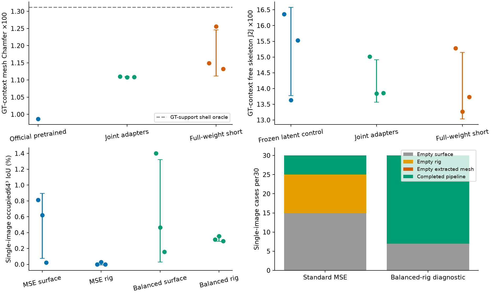
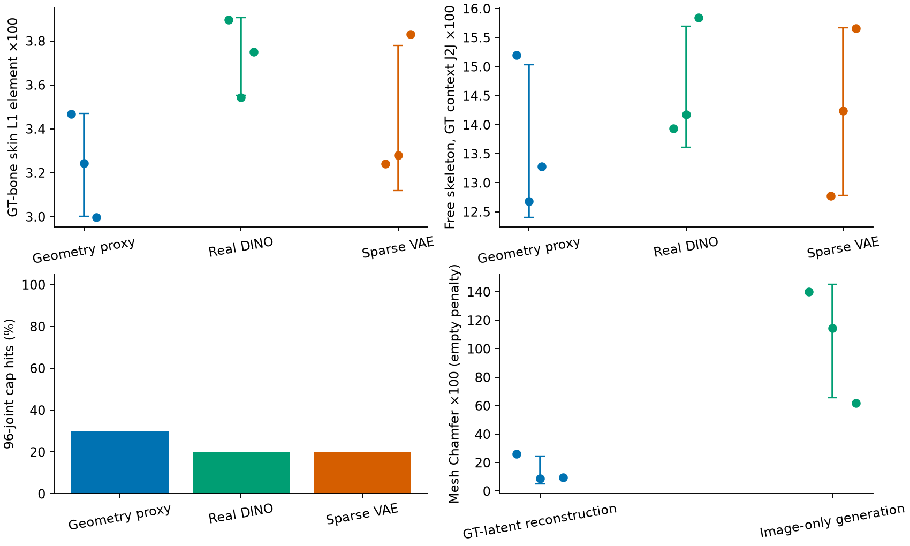
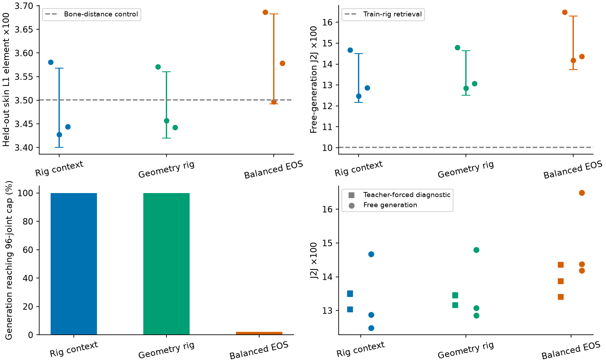
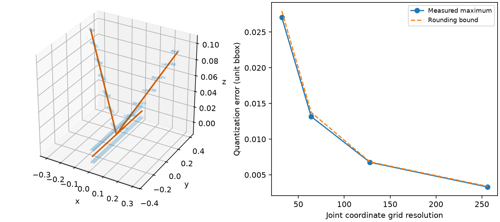

<div align="center">

<h1>Rigel3D: Rig-aware Latents for Animation-Ready 3D Asset Generation [Reproduction]</h1>

<p><strong>Rig-aware representations · Skeleton tokens · CPU & Apple Silicon</strong></p>

<p><a href="https://arxiv.org/abs/2605.13129"></a>


</p>

<p><a href="docs/method.md">📐 Method / 中文说明</a> · <a href="results/component_check.json">📊 Component checks</a> · <a href="COVERAGE.md">🔍 Coverage</a></p>

</div>

Independent partial implementation with original Anymate training, actual DINO features, sparse VAEs and a small image-only generation path. **Original architecture and paper tables remain unreproduced; geometry and EOS failures persist.** Code and reviewed results are published here; see [publication scope](docs/publication.md). The author repository currently contains a Coming Soon placeholder.

## Official TRELLIS priors and full-weight joint update

[Round3 source/rebuild audit](docs/round3_experiments.md) · [All-seed report](results/round3/REPORT.md) · [Scalar summary](results/round3/summary.json).

Actual official TRELLIS **85.8M surface encoder,90.9M mesh decoder and64³↔16³×8 occupancy VAE** checkpoints are now loaded strictly and hash-verified. Native CPU/MPS sparse kernels preserve original parameter shapes,12 shifted-window blocks and64→128→256 subdivision. Actual features use **DINOv2-L/reg1024-channel `x_prenorm`**, replacing round2's smaller feature interface. Four native224px neutral views are still upsampled to518; original render/data scale is not reproduced.

Three seeds complete2000-step joint adaptation, then250 additional steps updating the **full85.8M rig encoder and90.9M mesh decoder** with rig attention/AR/skin modules. Surface latents remain frozen as the paper specifies. This is actual full-weight backward/update, independently replayed on CPU/MPS; it still uses16-cube SDF-surrogate patches rather than the original full rendering losses and is not convergence-scale training. Large updated checkpoints remain local/ignored with hashed manifests.



*Fixed25 train/6 validation/10 test cohort; three seeds. Top: GT-conditioned reconstruction and GT-context free skeletons. Bottom: strict single-image generation after full-weight adaptation; standard loss and foreground-balanced diagnostic stay separate. Dots: seeds; error bars: sample SD. GT-support shell is a non-learned oracle, not generation. Completed pipeline does not mean correct geometry or animation.*

**GT-conditioned:** official mesh reconstruction10/10 nonempty, Chamfer×100 **0.987**. A zero-channel shell from the same GT support already gets **1.311**, so low reconstruction distance cannot establish image-to-shape generation. Official occupancy VAE GT-reconstruction IoU is **0.983796(surface)/1.000000(rig)**. After short full-weight joint tuning, GT-context J2J×100 is **14.091±1.056**, with **15/30** cap hits; geometry/EOS remain inaccurate.

**Strict single image:** standard velocity MSE completes **5/30** pipelines:15 fail with empty surface occupancy,10 with empty rig occupancy. A separately labeled foreground-balanced loss diagnostic completes **23/30**, but rig occupancy IoU is only **0.003212±0.000304**. Improving nonempty counts does not establish location accuracy. No GT positions/counts are substituted and no top-k clipping hides budget failures.

**28 tests pass.** Frozen-surface parameters are checked bitwise; first/last full rig/mesh transformer blocks demonstrably update. Full-encoder/mesh CPU/MPS probes and12 selected flow replay probes pass. Three frozen-latent decoder checkpoints also retain independent CPU validation replay. Semantic labels, textures, original pretrained flow transformers, original rendering metrics/baselines and full-paper numerical reproduction remain missing.

Standalone full-weight image entry (standard objective):

```sh
.venv/bin/python scripts/generate_trellis_image.py --image /absolute/path/input.png --output /absolute/path/new-output --seed 0 --noise-seed 123 --full-joint --joint-run full_joint --flow-run flows_full_joint
```

The diagnostic branch uses `--flow-run flows_full_joint_balanced`. Read `status.json`: source-empty, rig-empty, budget and extracted-mesh failures are distinct. The fixed first-test-image diagnostic CLI exported283676 vertices,566286 faces,45 joints and per-vertex generated-bone weights; its low rig consistency and degenerate bones remain recorded, so this export is not a fidelity success.

## Round2 real-DINO and small-VAE pilot (historical)

[Rebuild and inference boundaries](docs/round2_experiments.md) · [All-seed report](results/round2/REPORT.md) · [Scalar summary](results/round2/summary.json).

The fixed original-mesh cohort has **25 train /6 validation /10 test** assets (24/6/10 eligible skeletons). Actual frozen DINOv2-S features replace geometry proxies. Coordinate-aware surface/rig Sparse VAEs include sparse neighborhood convolution, reparameterization and KL; six models train on MPS. Nine paired decoder runs use the faster Mac CPU. All nine decoder checkpoints and six VAEs replay on CPU; **21 tests pass**.



*Three seeds per condition. Left/top and cap plots are GT-rig-conditioned reconstruction; skin accuracy uses GT bones. Bottom right separates GT-latent mesh reconstruction from image-only generation. Empty meshes receive a stated unit-box-diameter penalty; this plot is not a paper-table comparison.*

**DINO does not fix joint error in this pilot.** J2J×100: geometry proxy **13.722±1.315**, real DINO **14.651±1.042**, VAE latents **14.223±1.444**; 96-joint cap hits **9/30,6/30,6/30**. The single-training-asset control does memorize all37 joints and EOS, so the held-out failure is not explained solely by a universally broken stop or causal implementation.

Actual upstream FlexiCubes passes CPU/MPS extraction and gradients. Three small flow/field models execute the full image→predicted occupancy/latents→mesh→free skeleton→skinning path. **At CFG5 only13/30 generated meshes are nonempty;17 are empty.** GT-latent reconstruction is separately29/30 nonempty. CFG1/3 sensitivities give16/30 and15/30 nonempty, without solving skeleton error. Successful file export is not visual or rigging correctness.

The models are deliberately small and randomly initialized: DINO-S/224 views, independent seven-neighbor sparse VAEs, direct16³ occupancy MLP flows and a weak-SDF field decoder. They omit pretrained TRELLIS initialization, original occupancy VAEs/flow transformers, original rendering losses and learned FlexiCubes deformations. Labels, textures and retargeting are missing. Raw assets/views/qualitative asset figures remain local; no raw dataset is published.

Generate from one supplied image after training:

```sh
.venv/bin/python scripts/generate_image.py --image /absolute/path/input.png --output /absolute/path/new-output --seed 0 --noise-seed 123
```

The entry point needs no GT mesh, skeleton, skin, joint count, prefix or occupied coordinates. Outputs include `status.json`; inspect failure flags before using the exported asset.

## Round1 original-data training (historical)

[Detailed audit and reproduction commands](docs/anymate_experiments.md) · [All-seed results](results/round1/REPORT.md) · [Machine-readable summary](results/round1/summary.json).

96 train /16 validation /32 test assets were extracted from fixed official splits using bounded ZIP ranges, CRC and SHA checks. No asset/source family overlaps across splits. Skeleton tasks retain 83/14/32 valid single-root rigs; all selected assets remain in the skinning task with zero-weight points explicitly masked. Nine MPS training runs completed: three seeds each for GT-rig reconstruction context, a geometry-rig control, and an explicit balanced-EOS diagnostic. Width64, two layers, 2000 steps, 256 training/512 evaluation points; 16 tests passed and all nine selected checkpoints replayed on CPU.



*32 official test assets, three seeds per condition; dots are seeds and error bars are sample SD. Skinning uses supplied GT bones; rig-context features also encode GT skinning. The geometry-rig control still receives GT bone geometry. These are reconstruction proxies, not image-conditioned generation. Local controls are not original-paper baselines.*

Skin element L1×100: **3.484±0.084** (rig) versus **3.490±0.070** (geometry-rig) and **3.501** (bone-distance control). Unweighted EOS reaches the 96-joint cap in **96/96** test evaluations for each condition. Balanced EOS reduces cap hits to **2/96**, while J2J×100 worsens from **13.341±1.167** to **15.015±1.281**; the train-rig retrieval control gets **10.015**. Failures and all seeds are retained.

At that stage, the full-generation data preflight traced original asset hashes, verifies one original training FBX, renders four views and extracts official frozen DINOv2 features. Visibility-aware projection yields 1028 active surface voxels with 384 feature channels. That one-asset preflight was separate from the nine geometry-feature runs; round2 above adds the learned components and explicitly reports their failures.

## Method and feasibility

See [the source-checked explanation](docs/method.md) for coupled surface/skeleton latents, the full training/generation pipeline, original multi-GPU training requirements, Mac implementation route, missing settings and dataset access. A small attention component running on MPS does not establish that the CUDA-based TRELLIS pipeline or full Rigel3D training has been ported.

## Installation and execution

```sh
python3.12 -m venv .venv
source .venv/bin/activate
python -m pip install -e . pytest
python -m pytest -q --junitxml=results/tests.xml
python scripts/diagnose.py       # CPU components
python scripts/diagnose.py --mps # CPU/MPS forward/backward comparison; requires GPU access
```

Exact installed versions are recorded in `requirements-lock.txt`. Diagnostics explicitly overwrite their small generated summary/plot; copy `results/` first to preserve another device configuration. No dataset, model weight, API key or paid service is needed for these untrained component checks. External inputs, if added, belong in ignored `data/external/`, with provenance and hashes retained separately.

## Implemented scope

Bone feature pooling (Eq.2), bone-segment occupancy and overlapping-feature means; global-per-depth BFS ordering, coordinate quantization and parent-tree validation; and a small point–bone attention/softmax decoder (Eq.7) attending to two separate input feature sets. These feature tensors are not represented as pretrained DINO/TRELLIS SLats.

Initial eight tests cover independent weighted averages, closed-cell boundary cases and segment reversal, overlapping bones, tree invalidity, 100 random tree permutations, quantization error bounds, bone permutation equivariance, normalized skinning weights and gradients into both feature sets. Eight new tests cover safe metadata views, causal teacher forcing, constrained parent/EOS behavior, padding invariance, free generation, distance metrics and original sparse-skinning adaptation.

## Executed checks and limits



*Left: actual 64³ closed-cell voxelization of a procedural five-joint tree, not a generated asset. Right: measured quantization errors over 3200 random joints at each resolution, seed 2026, versus the declared rounding bound. These checks measure representation behavior, not learned joint accuracy.*

At resolution 128, the measured maximum quantization error is 0.006754 in unit-box coordinates (bound 0.006819). A 46,208-parameter **untrained** skinning component runs one forward/backward with 512 points, 32 bones and 128/64 context tokens; CPU/MPS output maximum difference is 1.49e-8 and gradient maximum difference is 1.75e-9. Timings include first-call overhead and are not a speed benchmark or a full-model memory estimate.

Now implemented: trained small AR skeleton and skinning decoders with positional encodings/masks and original subset adaptation. Still missing: pretrained surface/rig Sparse VAEs, geometry/FlexiCubes decoder, occupancy VAEs, four trained flow models, actual OpenCLIP label model and full benchmark comparisons. See [coverage](COVERAGE.md). There is no claim of image-to-rigged-asset inference.

## Evidence and collection

Source snapshot hashes: `sources/manifest.json`. Check output: `results/component_check.json`; test evidence: `results/tests.xml`. Original paper, upstream models and datasets retain their respective terms; no assets or weights are distributed here.

[Research Reproductions collection](https://github.com/gulucaptain/Research-Reproductions) · [Project Page](https://research-reproductions.gulucaptain666.chatgpt.site)

## Publication and provenance

See [publication scope](docs/publication.md), [research snapshot and omitted artifacts](PUBLICATION.json), and [public file hashes](PUBLICATION_FILES.json). Raw external data, third-party pretrained weights and virtual environments are not included.
